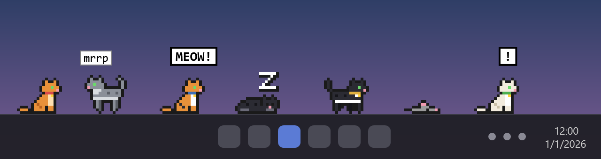
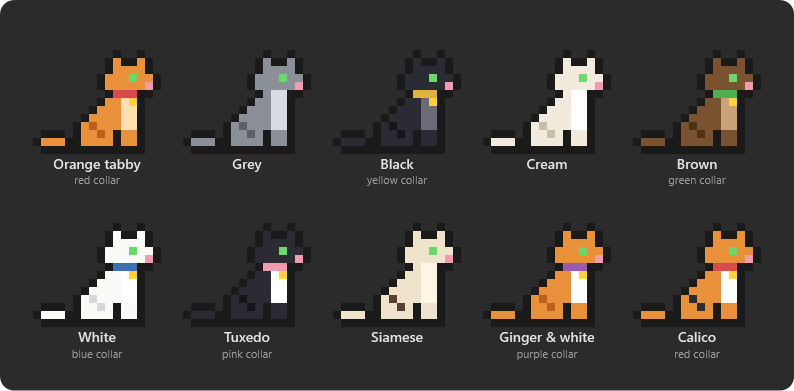
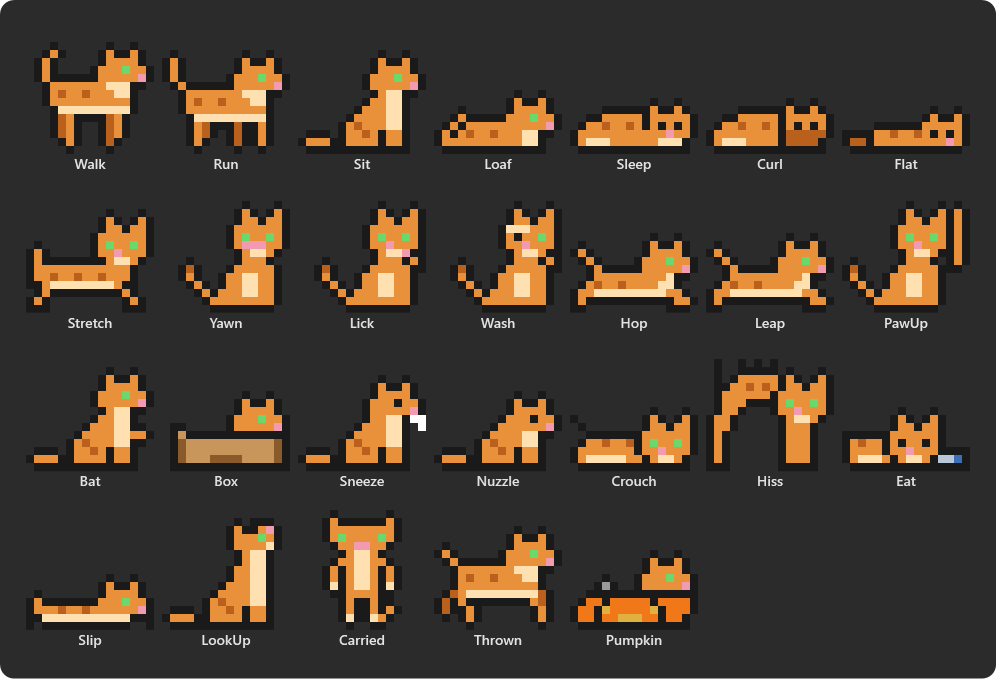
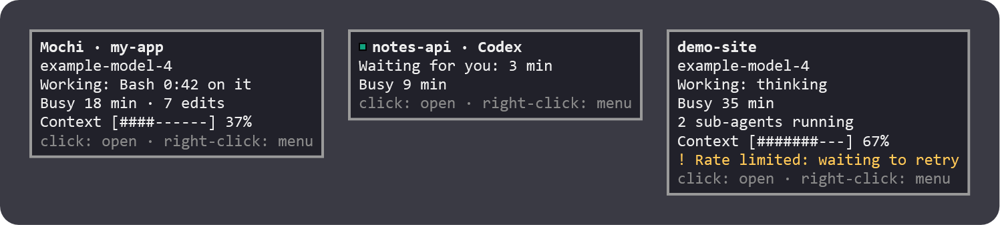
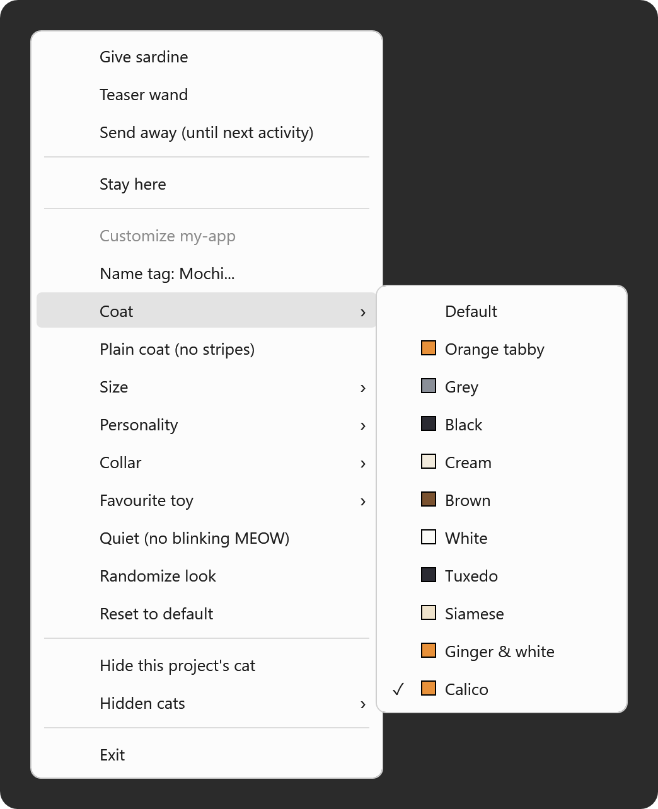

# taskbar-cats  =^.^=

**Pixel cats that live on your Windows taskbar, one per AI coding session.** Busy cats chase mice and play, idle ones nap. Click a cat to jump to its conversation.

[](https://github.com/tindll/taskbar_cats/releases/latest)




*Illustration: a made-up taskbar, drawn with the app's own sprites.*

## Meet the cats

Every project's cat gets its own look: ten coats, optional collars with a little gold medallion, three sizes. A cat's size follows its model (small for Haiku, big for Opus and Fable) unless you pick one.



And they do more than sit:



## What each cat is doing

| You see | It means |
|---|---|
| Chasing a mouse, batting a yarn ball, watching a bird | The session is busy (the favourite toy follows its personality, or the one you picked) |
| Batting at something | Editing: Edit, Write, MultiEdit |
| Looking up | Fetching from the web: WebFetch, WebSearch |
| Yarn ball grows | Edits since you last typed (steps at 3 and 8) |
| Rounder belly | The context window is filling (steps at 40% and 70%) |
| Kittens trotting along | Sub-agents are running (up to three) |
| Sitting in a cardboard box | The model has been thinking for 20 seconds with no tool running (a pumpkin from 17 October) |
| `!` bubble, paw up | Waiting for you (a permission prompt, for example) |
| Blinking `MEOW!` | Finished, your turn. Click the cat to acknowledge it |
| `good job !` | A turn that ran 10 minutes or more ended normally |
| Resting, then napping | A very long run (after 30 and 60 minutes) |
| `rate limit` murmur | Rate limited: waiting to retry |
| Zzz, curled up or flat out | A MEOW nobody clicked for 2 minutes: the cat falls asleep |
| Slip, sneeze, startle | A tool error, a context compaction, an API error or an interrupted turn |

Small murmurs (`mrrp`, `?`, a heart) appear now and then. **Quiet** in the cat's menu stops them and the blinking.

## Hover for the details

Rest the pointer on a cat for a card: project, model, what it is doing and for how long, edits and errors, sub-agents, context fill, API trouble. Cards are on by default (tray icon, **Hover cards**).



*Sample data only: no real projects.*

## Make every project's cat its own

Right-click a cat. Choices are saved per project and kept between runs; there is no settings window.



- **Name tag**: up to 16 characters, shown on the hover card.
- **Coat**, and **Plain coat (no stripes)**.
- **Size**: Small, Normal, Big, or by model.
- **Personality**: Lazy, Hyper, Curious, Shy.
- **Collar**: Red, Blue, Green, Yellow, Pink, Purple, or none.
- **Favourite toy**: Mouse, Yarn, Bird, or it takes turns.
- **Quiet (no blinking MEOW)**.
- **Randomize look** and **Reset to default**.
- **Hide this project's cat**, and **Hidden cats** to bring it back.
- Also in the menu: Give sardine, Teaser wand, Send away (until next activity), Stay here / Free, Exit.

## Play with them

- **Sardine**: Give sardine puts a sardine on your cursor; click a cat to feed it. Feeding types one message into that conversation's own window.
- **Teaser wand**: a toy mouse follows your pointer and the cats run, sit and jump for it (tray icon or cat menu; it stops by itself after 3 minutes).
- **Yarn ball**: grab the ball and throw it; it bounces and rolls and the cat fetches it.
- **Pick up and throw**: hold a cat by the scruff and fling it, even to another monitor. It lands on its feet.
- **Tag**: idle cats from the same project chase each other now and then.
- **Roaming**: an idle cat sometimes wanders off onto the next monitor's taskbar.

## Works with

| Tool | How |
|---|---|
| Claude Code (VS Code extension and CLI) | Reads its own session files and transcripts under `%USERPROFILE%\.claude` (or `CLAUDE_CONFIG_DIR`). Nothing to install. |
| Codex | Hooks that taskbar-cats adds to its config (tray icon, **Coding tools**, **Install hooks**). Also needs a one-time `/hooks` trust inside Codex. |
| GitHub Copilot (CLI and VS Code agent mode) | Hooks, installed the same way. |
| Cursor | Hooks, installed the same way. |
| Gemini CLI | Hooks, installed the same way. |

Cats for the hook-based tools wear a small coloured dot by the ear (Codex green, Copilot purple, Cursor white, Gemini blue).

Updates: right-click the tray icon, **Check for updates**. If you installed hooks, an update rewrites their exe
path to `%LOCALAPPDATA%\TaskbarCats.App\current\TaskbarCats.exe`, which stays valid across updates.

## Install

1. Download `TaskbarCats.App-win-Setup.exe` from the [latest release](https://github.com/tindll/taskbar_cats/releases/latest).
2. Run it. No admin rights needed. Windows SmartScreen may warn because the installer is not code-signed yet:
   click **More info**, then **Run anyway**.
3. The cats start at once, on the taskbar, one per open Claude Code conversation. It installs for your user only
   (`%LOCALAPPDATA%\TaskbarCats.App`), adds a Start-menu shortcut and turns on Start with Windows
   (tray icon, **Start with Windows** toggles it).
4. Using Codex, Copilot, Cursor or Gemini? Tray icon, **Coding tools**, **Install hooks**. Codex also needs a
   one-time `/hooks` trust inside Codex.

Portable instead: download `TaskbarCats-portable-needs-dotnet10.exe` from the same release and run it (needs the
.NET 10 Desktop Runtime; no Start-menu entry, no auto-update, Start with Windows stays off until you tick it).

Build from source (.NET 10 SDK, Windows 11):

```
git clone https://github.com/tindll/taskbar_cats.git
cd taskbar_cats
dotnet build
dotnet run --project src/TaskbarCats
```

## Uninstall

Settings, Apps, Installed apps, **taskbar-cats**, Uninstall. This removes the app, the Start-menu shortcut,
the Start-with-Windows entry and any coding-tool hooks taskbar-cats installed. Your cat preferences in
`%APPDATA%\TaskbarCats` are kept; delete that folder to remove them too.

## Privacy

taskbar-cats runs entirely on your PC.

**It reads** (read-only): Claude Code's session files `%USERPROFILE%\.claude\sessions\*.json` and transcripts
`%USERPROFILE%\.claude\projects\**\<session>.jsonl`; and, for the other tools, the small event files their hooks
write to `%LOCALAPPDATA%\TaskbarCats\events`. It keeps only tool names, counts, timestamps, the model id, status
flags and the working folder.

**It never reads or keeps** message text, tool inputs or outputs, file contents, file paths or commands.

**It never sends** anything over the network. The only network access is **Check for updates**, and only when you
click it (it asks GitHub for the latest release).

**It writes**: its preferences to `%APPDATA%\TaskbarCats\cats.json`; the hook event files above; the
Start-with-Windows value `HKCU\Software\Microsoft\Windows\CurrentVersion\Run\TaskbarCats`; and, only if you choose
**Install hooks** (or run `TaskbarCats.exe hooks install`), hook entries in `~/.codex/hooks.json`,
`~/.copilot/hooks/taskbar-cats.json`, `~/.cursor/hooks.json` and `~/.gemini/settings.json` (only for tools that
are installed; a `.taskbar-cats.bak` backup is made of an existing file first). Feeding a sardine types one
message into that conversation's own window.

### Hooks

`TaskbarCats.exe hooks install` adds our entries to the config files above and leaves yours alone;
`hooks status` shows which tools have them; `hooks uninstall` removes them (the uninstaller does this for you).

## Development

`dotnet test TaskbarCats.slnx` runs the tests. Releases are built by `.github/workflows/release.yml` when a
`vX.Y.Z` tag matching `<Version>` in `src/TaskbarCats/TaskbarCats.csproj` is pushed.
The pictures in `docs/media` are generated from the app's own sprites and card code: `dotnet run --project tools/make-media`.

## Licence

Not yet licensed.
